<h1 align="left">Hey 👋 What's up?</h1>

###

I'm tranvlnh, a Vietnamese student at PTIT

###

## 💫 About me

✨ Creating bugs since 2021 📚 I'm currently learning Unity 🎯 Goals: Become a game developer 🎲 Fun fact: I love MeowMeow  :3

### Languages

  
  
  
  
  
  
  
  
  
  
  
  
  
  
  

## 📊 My Github stats

  
  
  

#

#

  

<!-- cool-readme:start -->

<picture>
  <source media="(prefers-color-scheme: dark)" srcset="https://raw.githubusercontent.com/tranvlnh/tranvlnh/cards/summary-dark.svg">
  
</picture>
<picture>
  <source media="(prefers-color-scheme: dark)" srcset="https://raw.githubusercontent.com/tranvlnh/tranvlnh/cards/languages-dark.svg">
  
</picture>

<picture>
  <source media="(prefers-color-scheme: dark)" srcset="https://raw.githubusercontent.com/tranvlnh/tranvlnh/cards/contributions-dark.svg">
  
</picture>
<picture>
  <source media="(prefers-color-scheme: dark)" srcset="https://raw.githubusercontent.com/tranvlnh/tranvlnh/cards/weekly-dark.svg">
  
</picture>

<!-- cool-readme:end -->
